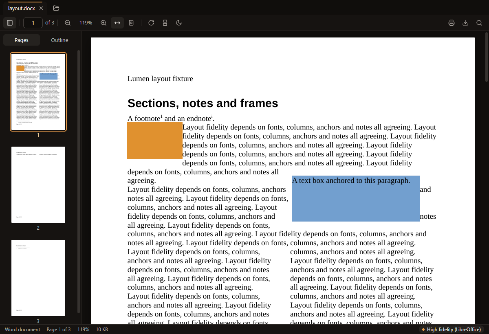
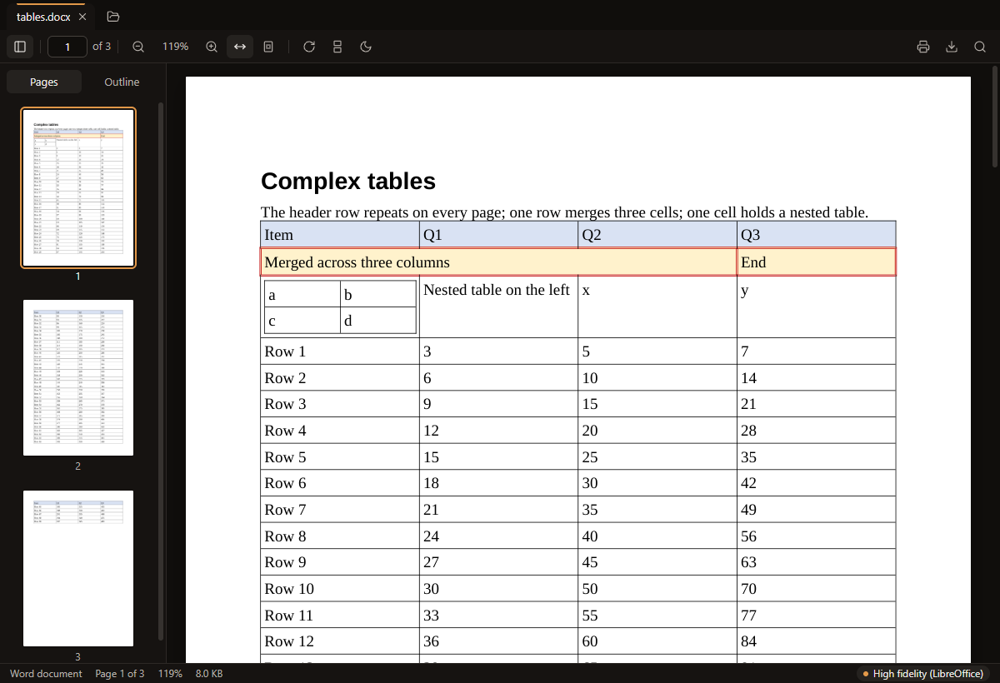
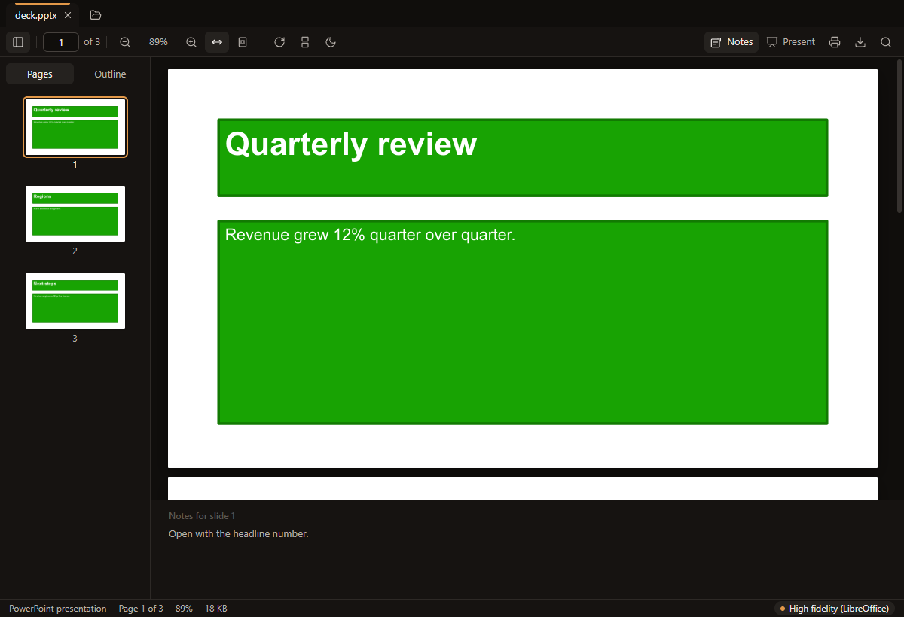
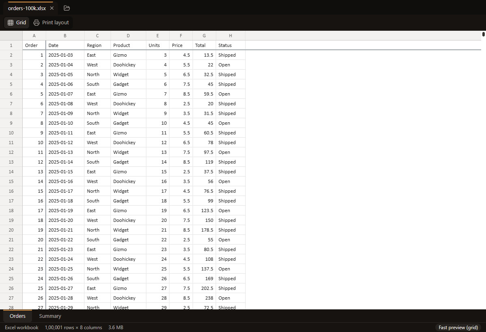
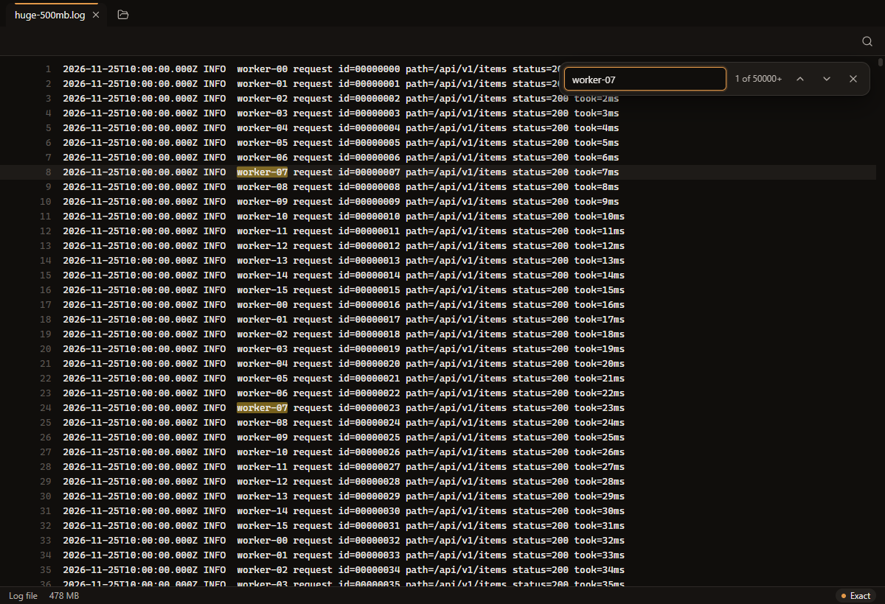
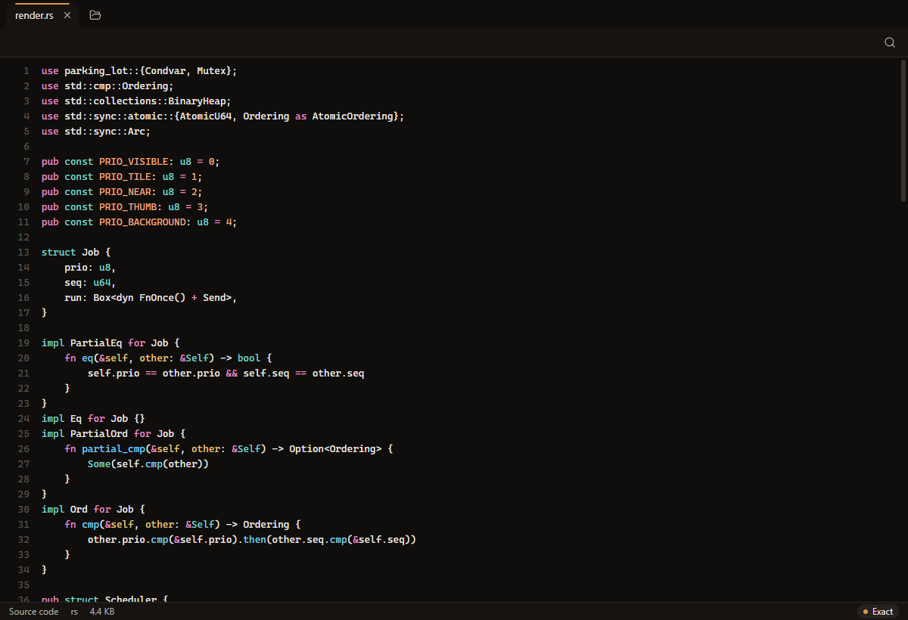
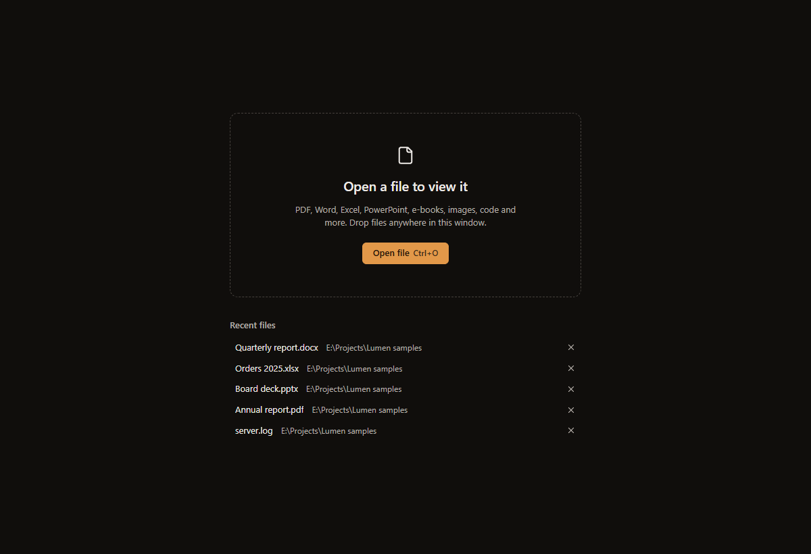

<div align="center">


# Lumen

**Open any document instantly. See it exactly as its author did.**

A fast, lightweight desktop viewer for PDF, Word, Excel, PowerPoint, e-books, email, code, logs and images. One small app, one window, every file.

[](https://github.com/Nuu-maan/lumen/actions/workflows/ci.yml)
[](#license)


[Download](#download) · [Getting started](#getting-started) · [Formats](#supported-formats) · [Performance](#performance) · [Build from source](#building-from-source)

<br>



</div>

## Why Lumen

Most people keep four or five apps around just to *look* at files: a PDF reader, an office suite, a text editor, an image viewer, a mail client. Lumen replaces them all for reading, and opens faster than any of them.

| | |
|---|---|
| **Instant** | The window appears in about 50 ms and the first page of a 100-page PDF is sharp in under 100 ms. A 500 MB log file shows its first screen in under 20 ms. |
| **Faithful** | Word, Excel and PowerPoint files render through a real layout engine (LibreOffice, or Microsoft Office when installed), not a lookalike. Tables, columns, footnotes, headers and speaker notes come out where the author put them. |
| **Honest** | A badge in the status bar always says which engine drew the page: *Exact*, *High fidelity* or *Fast preview*. You never mistake an approximation for the real thing. |
| **Light** | A 7.5 MB installer that uses the webview already on your system. No Electron, no bundled browser. |
| **Safe** | Documents are treated as untrusted: macros and PDF JavaScript never run, web content is sandboxed, and links ask before opening. |
| **Viewer only** | No editing, no accounts, no cloud, no telemetry. |

## A closer look

<table>
  <tr>
    <td width="50%"><br><sub><b>Word.</b> Merged cells, nested tables and repeating header rows, laid out by LibreOffice and drawn by MuPDF.</sub></td>
    <td width="50%"><br><sub><b>PowerPoint.</b> Slide thumbnails, speaker notes, and a full-screen presenter mode on F5.</sub></td>
  </tr>
  <tr>
    <td width="50%"><br><sub><b>Excel.</b> 100,000 rows open in about half a second, with frozen panes and sheet tabs. Switch to <i>Print layout</i> for the exact pages.</sub></td>
    <td width="50%"><br><sub><b>Huge text files.</b> A 478 MB log, memory-mapped and searchable, without loading it into RAM.</sub></td>
  </tr>
  <tr>
    <td width="50%"><br><sub><b>Code.</b> Syntax highlighting for 50+ languages.</sub></td>
    <td width="50%"><br><sub><b>Start screen.</b> Drop a file anywhere, or press Ctrl+O.</sub></td>
  </tr>
</table>

## Download

Get the latest installer from **[Releases](https://github.com/Nuu-maan/lumen/releases)**.

| Platform | File | Notes |
|---|---|---|
| **Windows 10/11** | `Lumen_x.y.z_x64-setup.exe` | Recommended. Installs for your user only, no admin rights needed. |
| | `Lumen_x.y.z_x64_en-US.msi` | For IT deployment. |
| **macOS 11+** | `Lumen_x.y.z_universal.dmg` | Apple Silicon and Intel. |
| **Linux** | `.AppImage` or `.deb` | Needs WebKitGTK 4.1. |

### Optional: LibreOffice for exact Office layout

Lumen opens Word, Excel and PowerPoint files on its own, as a fast text preview and a spreadsheet grid. For the **exact page layout**, install the free [LibreOffice](https://www.libreoffice.org/download/download-libreoffice/). Lumen finds it automatically, no setup required.

On Windows with **Microsoft Office** installed, you can render through Office itself for an exact match: click *Render with MS Office* in the status bar.

## Getting started

1. **Open a file.** Double-click any supported file (the installer registers Lumen for them), drag it onto the window, or press **Ctrl+O**. Recent files are listed on the start screen.
2. **Each file opens in a tab.** Opening another file while Lumen is running adds a tab to the same window.
3. **Check the badge** in the bottom-right corner. Office files first show *Fast preview* (extracted text, instant) and switch in place to *High fidelity (LibreOffice)* when the exact layout is ready, usually within a second. Reopening the same file later is instant because conversions are cached.
4. **Read.** Scroll, or use the toolbar to zoom, fit to width or page, rotate, switch between continuous and single-page mode, and invert pages for night reading.
5. **Find** with **Ctrl+F**. Matches are highlighted across the whole document.
6. **Print** with **Ctrl+P**, or **Export as PDF** with **Ctrl+Shift+S** to save an Office file, e-book or XPS as a PDF.

### Keyboard shortcuts

| Action | Shortcut |
|---|---|
| Open file | Ctrl+O |
| Close tab / next tab / previous tab | Ctrl+W / Ctrl+Tab / Ctrl+Shift+Tab |
| Find, next, previous | Ctrl+F, Enter or F3, Shift+Enter or Shift+F3 |
| Zoom in / out / actual size | Ctrl+= / Ctrl+- / Ctrl+0, or Ctrl+wheel and pinch |
| Fit width / fit page | Ctrl+1 / Ctrl+2 |
| Rotate | Ctrl+R |
| First / last page | Home / End |
| Previous / next page (single-page mode) | PgUp / PgDn, ← / → |
| Toggle sidebar | Ctrl+B |
| Print / Export as PDF | Ctrl+P / Ctrl+Shift+S |
| Present slides / exit | F5 / Esc (arrows, Space and PgDn advance) |

On macOS, use ⌘ in place of Ctrl.

## Supported formats

| Category | Formats | Rendered by |
|---|---|---|
| **PDF & e-books** | PDF, PDF/A, XPS/OXPS, EPUB, MOBI/AZW3, FB2, CBZ, multi-page TIFF | MuPDF |
| **Word processing** | DOCX, DOCM, DOTX, DOC, RTF, ODT, Pages, WPD, HWP | LibreOffice → PDF → MuPDF |
| **Spreadsheets** | XLSX, XLSM, XLSB, XLS, ODS, Numbers, CSV, TSV | Grid (calamine) and print layout (LibreOffice) |
| **Presentations** | PPTX, PPSX, PPT, ODP, Keynote | LibreOffice → PDF → MuPDF |
| **Diagrams & publishing** | VSDX, VSD, PUB | LibreOffice → PDF → MuPDF |
| **Email** | EML, MSG, with attachments that open in a new tab | mail-parser, CFB |
| **Web & Markdown** | HTML, MHT, Markdown | Sandboxed web view |
| **Text & code** | TXT, LOG, JSON, XML, YAML, and source code | Memory-mapped text engine with syntect |
| **Images** | PNG, JPEG, GIF, WebP, AVIF, BMP, ICO, SVG, HEIC (macOS) | System decoders |
| **Archives** | ZIP: browse and open any file inside | zip |

Formats are detected from the file's contents, not just its extension, so a misnamed file still opens correctly. Coming next: CBR, DjVu, HEIC on Windows, PSD and RAW previews ([#8](https://github.com/Nuu-maan/lumen/issues/8)).

## The engine badge

| Badge | What you're seeing |
|---|---|
| **Exact** | Rendered directly from the file itself: PDF, e-books, text, images, email. |
| **Exact (MS Office)** | Converted by your installed Microsoft Office. This is what the author saw. |
| **High fidelity (LibreOffice)** | Converted by LibreOffice, with near-Office layout for tables, fields, sections and charts. |
| **Fast preview** | Text extracted instantly while the exact layout renders. It's replaced in place when ready. |
| **Fast preview (grid)** | Spreadsheet cell values. Switch to *Print layout* for the exact pages. |

## Performance

Measured with `cargo run --release --bin bench`, which launches the real release build and times each scenario on a Windows 11 laptop. CI runs the same benchmark on every pull request and fails it on a regression of more than 20%.

| Scenario | Lumen | Budget |
|---|---:|---:|
| Installer size (NSIS) | **7.5 MB** | 25 MB |
| Window visible after launch | **52 ms** | 300 ms |
| First page sharp, 100-page PDF | **80 ms** | 150 ms |
| First page sharp, 137 MB PDF | **98 ms** | 400 ms |
| Word document, fast preview | **43 ms** | 300 ms |
| Word document, exact layout (20 pages) | **1.0 s** | 1.5 s |
| Excel workbook, 100,000 rows | **548 ms** | 1 s |
| 500 MB log file, first screen | **18 ms** | 200 ms |
| Reopen an Office file (cached) | **65 ms** | 200 ms |
| Idle memory, 100-page PDF | 196 MB | 120 MB ([#3](https://github.com/Nuu-maan/lumen/issues/3)) |

Lumen's own process uses about 11 MB of memory; the rest is the system webview (WebView2 on Windows). Rendering fidelity is checked against a reference corpus, see [FIDELITY.md](FIDELITY.md).

## Security

Every document is treated as untrusted.

- **No scripts.** PDF JavaScript is compiled out of MuPDF. Office macros are disabled.
- **Isolated conversion.** Office files load hidden and read-only in a separate LibreOffice process, with link updates off and a 60-second timeout.
- **Sandboxed web content.** HTML, Markdown and email bodies render in a `sandbox=""` iframe under a `default-src 'none'` Content-Security-Policy: nothing runs, nothing loads from the network.
- **Links ask first.** External links show the address and ask before opening your browser.
- **Safe archives.** ZIP extraction rejects path traversal and caps output size.

## Building from source

**Requirements:** Rust (stable), Node 22+ with pnpm, LLVM/libclang (for MuPDF's bindings). On Linux: `libwebkit2gtk-4.1-dev libappindicator3-dev librsvg2-dev`. LibreOffice is optional.

```sh
pnpm install
pnpm tauri dev                     # run with hot reload
pnpm tauri build                   # installers in src-tauri/target/release/bundle/
cargo test --manifest-path src-tauri/Cargo.toml
```

On Windows, set `LIBCLANG_PATH` to your LLVM `bin` folder if bindgen can't find it.

Benchmarks and fidelity checks:

```sh
python bench/gen_samples.py        # benchmark inputs (about 640 MB)
cargo run --release --manifest-path src-tauri/Cargo.toml --bin bench
cargo run --release --manifest-path src-tauri/Cargo.toml --bin fidelity
```

## Architecture

Lumen is a [Tauri 2](https://tauri.app) app: a Rust core does all parsing and rendering, and a small [Svelte 5](https://svelte.dev) interface displays the result in the system webview.

```
┌──────────────────────────── Svelte UI (system webview) ────────────────────────────┐
│  tabs · toolbar · virtualized pages · text layer · grid · find · presenter        │
└──────────────── Tauri commands  +  lumen:// protocol (page tiles) ────────────────┘
┌──────────────────────────────────── Rust core ─────────────────────────────────────┐
│  sniff + formats   detect the format from content, pick an engine                  │
│  render            priority scheduler: visible → tiles → nearby → thumbnails       │
│  mupdf             PDF, XPS, e-books: cached display lists, 512 px tiles, search    │
│  office            warm LibreOffice worker (or MS Office), cached by content hash  │
│  sheet             calamine grid with frozen panes                                 │
│  text              memory-mapped, background line index, syntect highlighting      │
│  email · markup · archive                                                          │
└────────────────────────────────────────────────────────────────────────────────────┘
```

## Roadmap

Open work is tracked in [issues](https://github.com/Nuu-maan/lumen/issues). Highlights:

- Lower idle memory ([#3](https://github.com/Nuu-maan/lumen/issues/3))
- More formats: CBR, DjVu, HEIC on Windows, PSD, RAW ([#8](https://github.com/Nuu-maan/lumen/issues/8))
- One-click LibreOffice download from inside Lumen ([#7](https://github.com/Nuu-maan/lumen/issues/7))
- Fast previews for more Office formats ([#9](https://github.com/Nuu-maan/lumen/issues/9))
- Fidelity references exported from Microsoft Office ([#13](https://github.com/Nuu-maan/lumen/issues/13))

## Contributing

Bug reports and pull requests are welcome. Please open an issue first for larger changes. Every pull request runs the frontend checks, the Rust tests on Windows and Linux, and the performance benchmark.

## License

Lumen is licensed under **[AGPL-3.0-or-later](https://www.gnu.org/licenses/agpl-3.0.html)** because it links **MuPDF** (AGPL-3.0, © Artifex Software). MuPDF was chosen for its speed and format coverage. A build that can't be AGPL could swap in PDFium, at the cost of the non-PDF e-book formats.

| Component | License |
|---|---|
| MuPDF | AGPL-3.0 |
| LibreOffice (separate process, not bundled) | MPL-2.0 |
| Tauri, Svelte, calamine, syntect, pulldown-cmark, mail-parser, zip, quick-xml, blake3 | MIT and/or Apache-2.0 |
| Icons adapted from Lucide | ISC |
